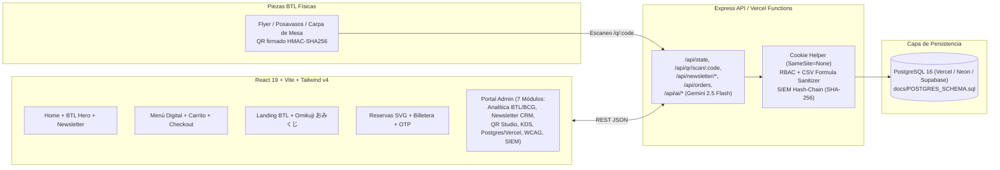

# Kaonashi Phygital Platform (v6) — BTL Attribution, Newsletter CRM & Restaurant Analytics

Plataforma full-stack de activación **BTL (Below-The-Line)**, atribución de códigos QR firmados con HMAC-SHA256, **Newsletter CRM con doble opt-in**, **Analítica Ejecutiva (Embudo BTL de 10 etapas, Matriz BCG de Ingeniería de Menú, Pronóstico de Perecederos)**, reservaciones con plano SVG y KDS de cocina en tiempo real, diseñada para despliegue en **Vercel** y persistencia en **PostgreSQL**.

---

## Arquitectura del Sistema



---

## Características Principales Implementadas

1. **Atribución BTL & Códigos QR Firmados (`src/lib/qr.ts`)**:
   - Códigos cortos Crockford Base32 (`KNS-XXXXXX`) libres de caracteres ambiguos (`0/O/1/I/L`).
   - Firma criptográfica `HMAC-SHA256` con comparación en tiempo constante (`constantTimeEqual`).
   - Bloqueo de redirecciones abiertas (`isValidInternalDestination`) restringido a `/menu`, `/c/:slug`, `/r/:branchSlug`.
   - Atribución first-touch y last-touch (`kns_Touch_first`, `kns_Touch_last`) a lo largo de 10 etapas.

2. **Newsletter CRM & Estudio de Campañas (`/api/newsletter/*`)**:
   - Captura de suscriptores con **Doble Opt-In simulado** (bandeja de entrada integrada en vivo para confirmar en 1 clic sin SMTP externo) y registro de consentimiento GDPR/Habeas Data (`privacyPolicyVersion: v2025.05`).
   - Segmentación por sucursal (`Bogotá Zona T`, `Medellín Provenza`, `Tokyo Shibuya Crossing`), idioma (`ES`, `EN`, `JA`) y etiquetas (`omakase-lovers`, `btl-vip`, `sake-club`, `weekend-brunch`).
   - Constructor de campañas con vista previa en vivo, inyección de cupones dinámicos y analítica de tasa de apertura, CTR, bajas e ingresos atribuidos.

3. **Hub de Analítica de Datos (`src/lib/analytics.ts`)**:
   - **Embudo de Conversión BTL de 10 Etapas**: `1_distributed` → `2_unique_scans` → `3_landing_views` → `4_omikuji_plays` → `5_leads_captured` → `6_coupons_issued` → `7_cart_adds` → `8_checkout_starts` → `9_orders_paid` → `10_repeat_orders_30d`.
   - **Leaderboard de Touchpoints Físicos**: Costo por Scan, CPL, CPO, ROAS y etiquetas de recomendación automática (`Scale`, `Fix landing`, `Stop`).
   - **Matriz BCG de Ingeniería de Menú**: Clasificación automática de platos en `Star` ⭐, `Plowhorse` 🐎, `Puzzle` 🧩 y `Dog` 🐾 según popularidad e índice de margen de contribución.
   - **Pronóstico de Inventario Perecedero**: Media móvil ponderada de 7 días para `otoro_sashimi_grade`, `uni_hokkaido_tray`, `wagyu_a5_striploin`, etc., con alertas de reorden y riesgo de merma.
   - **Insights Ejecutivos con Gemini (`POST /api/ai/admin-insights`)**: Resumen narrativo fundamentado exclusivamente en las métricas calculadas del servidor.

4. **Motor Financiero en Unidades Menores (`src/lib/money.ts` & `src/lib/pricing.ts`)**:
   - Cero coma flotante para dinero: `COP` y `JPY` con exponente `0`; `USD` y `EUR` con exponente `2`.
   - Pipeline determinista de 8 pasos (`computeOrderPricing`) y validador de cupones de 9 pasos (`validateCouponInOrder`).

5. **Seguridad, RBAC, SIEM y Accesibilidad WCAG (`src/lib/security.ts`)**:
   - Cadena de auditoría SIEM inmutable (`prevHash` + `entryHash` SHA-256) con verificador de integridad en tiempo real.
   - Sanitización contra inyección de fórmulas CSV (`=`, `+`, `-`, `@`, `\t`, `\r`) en todas las exportaciones.
   - Verificador de contraste WCAG 2.1 AA (`>= 4.5:1`) para los 4 temas (`Kyoto Zen`, `Tokyo Neon`, `Edo Tradition`, `Osaka Minimal`).

---

## Credenciales de Demostración

### Portal Administrativo (Staff RBAC + 2FA TOTP)
| Rol | Email | Contraseña | Código TOTP 2FA | Permisos |
| :--- | :--- | :--- | :--- | :--- |
| **Admin** | `admin@kaonashi.co` | `KaonashiAdmin!2025` | `123456` | Acceso total (Analítica, Newsletter, QR, KDS, Postgres, Branding, SIEM) |
| **Manager** | `manager@kaonashi.co` | `KaonashiMgr!2025` | `123456` | Campañas, Newsletter, QR, KDS, Analítica |
| **Kitchen** | `chef@kaonashi.co` | `KaonashiChef!2025` | *(No requerido)* | KDS de cocina |
| **Cashier** | `cashier@kaonashi.co` | `KaonashiCash!2025` | *(No requerido)* | Redención POS de cupones |

### Cuentas de Clientes (Billetera & Reservas)
- **Google OAuth Simulado (1-clic)**: `sofia.restrepo@example.com` (Tier `GOLD`, 1,420 pts) o `kenji.takahashi@example.jp` (Tier `BLACK_MASK`, 3,890 pts).
- **Email OTP (6 dígitos)**: Ingresa cualquier correo en la vista **Reservas & Billetera**; el código OTP aparece instantáneamente en el panel **Bandeja de Entrada Simulada**.

---

## Variables de Entorno (`.env.example`)

| Variable | Descripción |
| :--- | :--- |
| `DATABASE_URL` | Cadena de conexión PostgreSQL con pooling (ej. Vercel Postgres / Neon `-pooler` puerto 5432/6543). |
| `DIRECT_URL` | Cadena de conexión directa PostgreSQL para migraciones DDL (`docs/POSTGRES_SCHEMA.sql`). |
| `QR_HMAC_SECRET` | Secreto de >= 32 bytes para firmar códigos QR (`HMAC-SHA256`). |
| `SESSION_SECRET` | Secreto para firmar cookies de sesión (`SameSite=None; Secure`). |
| `CRON_SECRET` | Token Bearer para autorizar jobs programados en Vercel Cron. |
| `GEMINI_API_KEY` | Clave de API de Google Gemini (usada únicamente en el servidor Express). |

---

## Ejecución Local y Despliegue en Vercel + PostgreSQL

```bash
# 1. Instalar dependencias
npm install

# 2. Ejecutar suite de pruebas unitarias (node:test)
npm test

# 3. Iniciar servidor de desarrollo full-stack (puerto 3000)
npm run dev

# 4. Compilar para producción
npm run build
```

Para aprovisionar la base de datos PostgreSQL en producción (Vercel Postgres, Neon o Supabase):
```bash
psql "$DIRECT_URL" -f docs/POSTGRES_SCHEMA.sql
```
